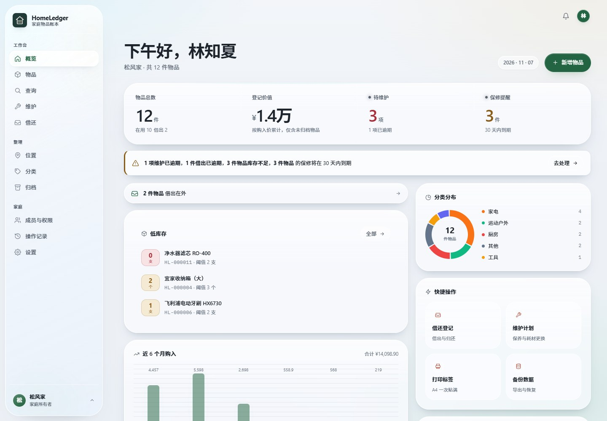
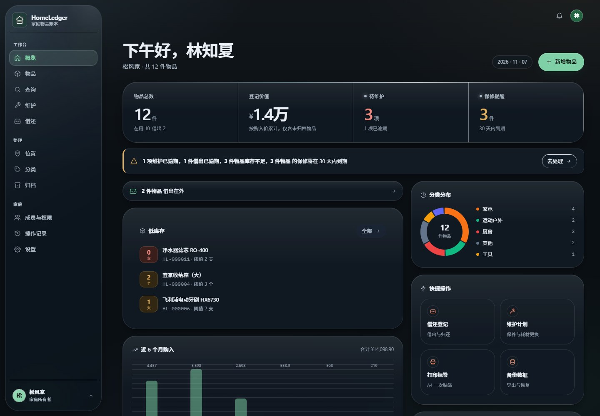
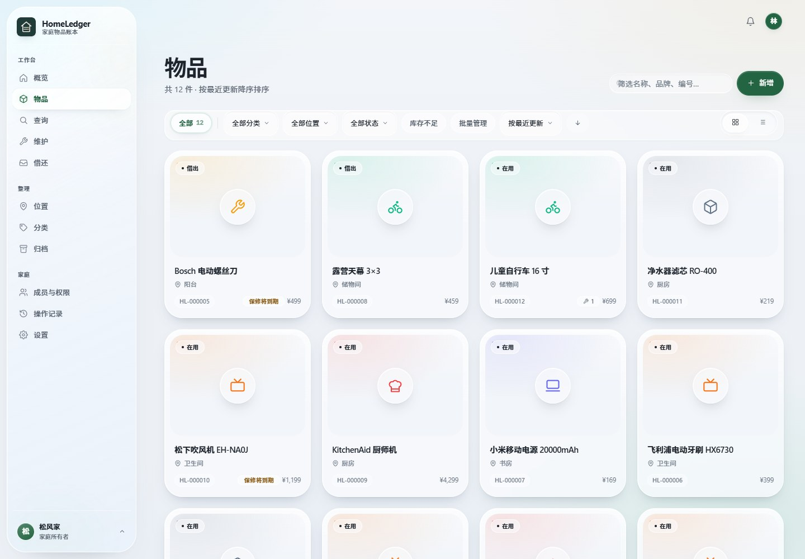
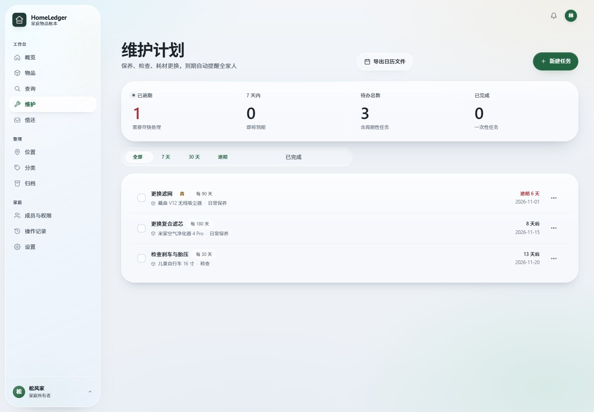
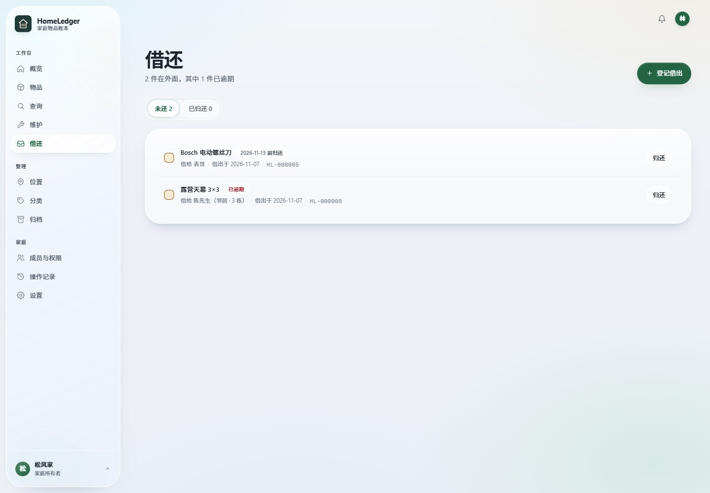
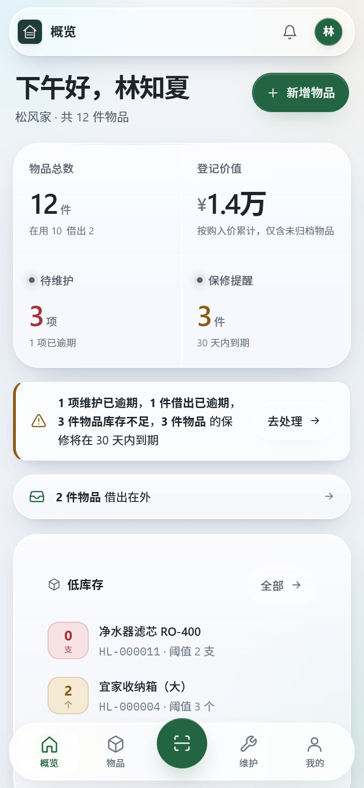
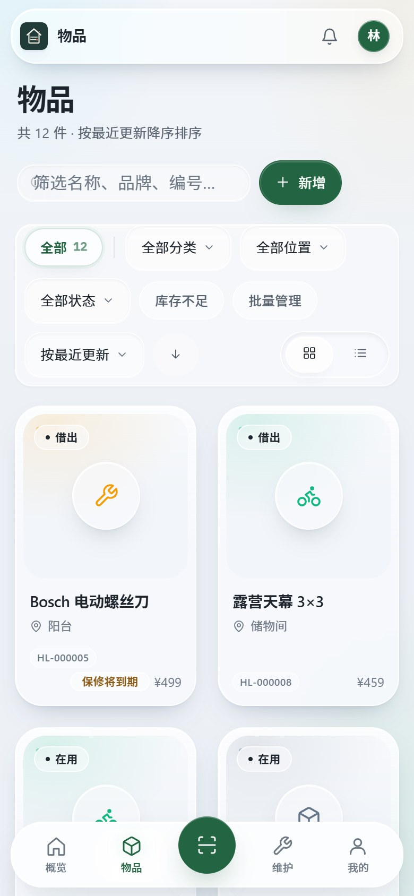
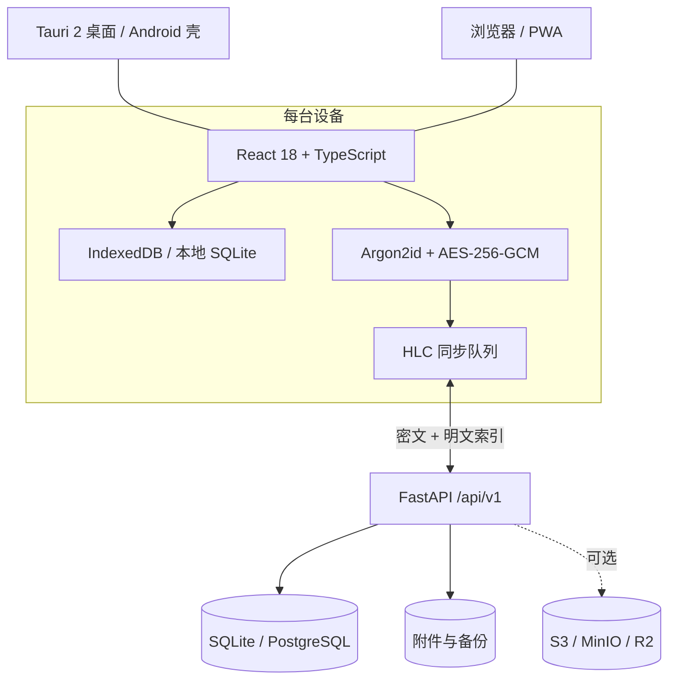

<p align="center">
  
</p>

<h1 align="center">HomeLedger</h1>

<p align="center">
  <strong>家庭物品台账 · 本地优先 · 端到端加密同步</strong><br>
  把家里的每一件东西，放进一本随时查得到的账。
</p>

<p align="center">
  <a href="https://github.com/Bronsan/HomeLedger/releases"></a>
  <a href="LICENSE"></a>
  <a href="#download"></a>
  <a href="#tests"></a>
  <a href="https://bronsan.github.io/HomeLedger/"></a>
</p>

<p align="center">
  <a href="https://bronsan.github.io/HomeLedger/">项目介绍</a> ·
  <a href="#download">下载</a> ·
  <a href="#features">功能</a> ·
  <a href="#deploy">部署</a> ·
  <a href="#docs">文档</a> ·
  <a href="#privacy">隐私</a> ·
  <a href="COMMERCIAL.md">商业授权</a>
</p>

<p align="center">
  
</p>

<p align="center"><sub>桌面端概览 · 晨雾主题 · 亮色</sub></p>

---

HomeLedger 是一本给家庭用的物品台账：从购入、存放、保修、维护，到借出、归还、批次到期，都能在一个地方查清楚。

它默认把数据留在你的设备上：不需要注册，不依赖云服务，断网也能增删改查。需要多设备共享时，再打开端到端加密同步；需要多人协作时，把它跑在家里的 NAS、旧笔记本或树莓派上。

**适合这样的人：** 不想把家里的清单交给第三方，又需要一家人共同维护；想要表格的结构，但不想自己拼公式、权限和备份。

> **许可说明：** HomeLedger 是 **source-available（源码公开）**，不是 OSI 定义的开源软件。个人、家庭、学习和研究等非商业用途免费；商业使用需要单独书面授权。详见 [许可证](#license)。

---

<a id="features"></a>

## 功能

| 能力 | 你能做什么 |
| --- | --- |
| **物品档案** | 编号、型号条码、序列号三者分离；数量单位、成色、状态、购置与保修、自定义字段、标签 |
| **分类与位置** | 分类支持树形；位置支持“房间 → 家具 → 容器 → 区域”四级，统计向上汇总，防止循环引用 |
| **文档附件** | 图片自动生成缩略图，支持封面、按类型归档、软删除；下载走 ETag 与 UTF-8 文件名 |
| **维护计划** | 周期任务完成后自动顺延，一次性任务结案；逾期/临近双维度筛选；花费与记录写入物品时间线 |
| **借还管理** | 借出人、联系方式、应还日期、逾期状态；逾期自动提醒，归还留记录 |
| **设备组件** | 主机与配件、耗材、扩展件关联，可单独记录序列号与安装时间 |
| **批次与保质期** | 同一物品分批次记录，每批各带生产日、到期日与存放位置；到期前 30 天预警，过期标红 |
| **二维码与标签** | 单件二维码、贴纸 PNG、A4 三列打印页、批量 ZIP；手机相机扫码即可打开只读查看页，不用装 App |
| **扫码与查询** | 手机摄像头扫码（`BarcodeDetector`，不支持时退回 jsQR）；桌面端按编号、条码、序列号、名称或整串 URL 查询 |
| **批量导入导出** | CSV 中英文表头自动映射、预检（dry-run）、边导边建分类位置；CSV/JSON 全量导出 |
| **权限体系** | 5 个角色、23 项细粒度权限、成员级授予/禁止覆盖、物品级共享 |
| **实时协作** | 家里任何一个人改了东西，其他人的页面自动更新；SSE 只推“哪个实体变了”，不推行内容 |
| **审计与追溯** | 所有写操作落审计日志；物品另有面向人阅读的时间线；软删除 + 归档双机制 |
| **备份恢复** | 在线一致性快照（SQLite backup API）；恢复需输入确认词，恢复前自动留底 |
| **通知** | 站内、邮件、Webhook 三通道，按“任务 + 到期日”去重，重启不重复提醒 |
| **加密同步** | 字段级明文/密文分层；口令派生密钥，服务器解不开隐私字段与附件 |
| **AI / OCR 录入** | 可替换的 `AIProvider`；默认本地启发式零联网，云端识别必须显式同意 |
| **多端** | Windows 安装版 / 便携版、Android APK、浏览器 / PWA；桌面端托盘常驻、单实例、关窗不退出 |

### 找得到

- 四级位置树 + 树形分类，统计向上汇总。
- 编号、条码、序列号、名称、整串 URL 都能查。
- 桌面端 `⌘K` / `Ctrl+K` 命令面板，键盘直达页面和操作。
- 标签打印支持单件、贴纸、A4 三列和批量 ZIP；二维码指向服务器渲染的只读页，家里网络内用手机相机直接扫开。

### 不会忘

- 维护计划支持周期任务和一次性任务；完成后自动顺延，逾期和临近分开筛选。
- 保修到期、借出逾期、批次临期都进入提醒中心，首页卡片同步显示。
- 维护花费、记录、附件进入物品时间线，不用另开表格。
- 可选邮件 / Webhook 通知；默认只用站内提醒。

### 一家人一起用

- 5 个角色：所有者、管理员、成员、只读、访客；23 项权限可细调。
- 成员级授予/禁止覆盖，物品级共享；默认拒绝，越权返回 404 而不是泄露存在性。
- 所有写操作落审计日志；谁在什么时候改了什么，能查。
- SSE 实时更新，不用手动刷新；断线自动重连，切到后台自动断开。

### 断网也能用

- 每台设备自带完整本地库（IndexedDB / SQLite），断网照常增删改查。
- 复网后按 HLC（混合逻辑时钟）收敛，冲突采用后写者胜，另一版保留在审计里。
- 同步口令只在本机派生密钥；私密字段和照片在离开设备前就已加密。
- 服务器只保存检索索引的明文字段和密文，读不到描述、序列号、价格、备注、联系方式与照片。

---

## 界面

| 概览 · 亮色 | 概览 · 暗色 |
| --- | --- |
|  |  |

| 物品列表 | 维护计划 |
| --- | --- |
|  |  |

| 借还管理 | 手机端 |
| --- | --- |
|  |  |

<p align="center">
  
</p>

<p align="center"><sub>截图使用演示家庭与演示物品；实际安装包不内置任何演示账号或示例数据。</sub></p>

---

<a id="deploy"></a>

## 三种使用方式

同一份代码、同一个镜像，差异集中在 `providers/deployment.py` 的能力矩阵里，路由层不做 `if mode ==` 分支。

| | 本地单机 `local` | 家庭网关 `gateway`（推荐） | 云服务器 `cloud` |
| --- | --- | --- | --- |
| 多成员 | ✗ | ✓ | ✓ |
| 局域网访问 | ✗ | ✓ | ✓ |
| 外网访问 | ✗ | 需 VPN / 反代 | ✓ |
| 定时任务 | ✗ | ✓ | ✓ |
| 对象存储 | ✗ | ✗ | ✓（S3 兼容） |
| 适用 | 个人、隐私优先 | 家庭首选 | 异地家庭 |

> **关键约束：** 网关模式下，所有终端必须通过 API 访问。不要用 SMB/NFS 把同一个 SQLite 文件共享给多台设备直接写入——SQLite 的锁是进程内语义，跨网络文件系统的锁不可靠，会造成静默损坏。这也是这个项目坚持“统一服务层”的原因。

**没有服务器也能共享。** 桌面端在“设置 → 同步”里点一次“允许家庭内设备连接”，它就开始在局域网提供登录页，把显示的 `http://192.168.x.x:端口` 填到手机上即可。默认关闭；能被同一 Wi-Fi 下所有设备访问的端口，应该由用户自己决定开不开。

---

<a id="download"></a>

## 下载

**最新版本：2.0.2-beta（2026-11-08）**

| 文件 | 平台 | 大小 | 说明 |
| --- | --- | --- | --- |
| [HomeLedger_2.0.2-beta_x64-setup.exe](https://github.com/Bronsan/HomeLedger/releases/download/v2.0.2-beta/HomeLedger_2.0.2-beta_x64-setup.exe) | Windows 10/11 x64 | 26.8 MB | NSIS 安装版；当前用户安装，不需要管理员权限 |
| [HomeLedger-2.0.2-beta-win-x64-portable.zip](https://github.com/Bronsan/HomeLedger/releases/download/v2.0.2-beta/HomeLedger-2.0.2-beta-win-x64-portable.zip) | Windows 10/11 x64 | 33.3 MB | 免安装；解压后双击 `HomeLedger\homeledger-desktop.exe` |
| [HomeLedger_2.0.2-beta_aarch64.apk](https://github.com/Bronsan/HomeLedger/releases/download/v2.0.2-beta/HomeLedger_2.0.2-beta_aarch64.apk) | Android 7.0+ arm64 | 6.9 MB | 固定 release key 签名；只含 `arm64-v8a` |

[SHA256SUMS-2.0.2-beta.txt](https://github.com/Bronsan/HomeLedger/releases/download/v2.0.2-beta/SHA256SUMS-2.0.2-beta.txt) · [版本说明](CHANGELOG.md) · [安装包说明](https://github.com/Bronsan/HomeLedger/releases/tag/v2.0.2-beta)

### 校验值（SHA-256）

```text
5ba21ae29e6f4fa151123521b1ef7474575abcbffd8e063e48dd7c329a55b9e5  HomeLedger_2.0.2-beta_x64-setup.exe
cd9090220a36fcced8291c930dcc44977b2389be2556883b5c2165f794f70103  HomeLedger-2.0.2-beta-win-x64-portable.zip
ce4b998152f3dfee3618f7eae2e0ac5317025043f4ee5a230a13c654b9695f3c  HomeLedger_2.0.2-beta_aarch64.apk
```

```powershell
# Windows PowerShell
Get-FileHash .\HomeLedger_2.0.2-beta_x64-setup.exe -Algorithm SHA256
```

```bash
# macOS / Linux
shasum -a 256 HomeLedger_2.0.2-beta_aarch64.apk
```

### 安装说明

**Windows**

- 安装版默认装到当前用户目录，不需要管理员权限；卸载时勾选“删除应用程序数据”会清除本机 WebView 数据和 `%APPDATA%\HomeLedger` 里的数据库、附件、备份与日志。
- 安装包使用固定的 HomeLedger 自签名证书（`CN=HomeLedger`）。自签名根证书不在 Windows 信任列表中，SmartScreen 会提示“未知发布者”；这是预期现象，首次运行选择“更多信息 → 仍要运行”。
- 想彻底消除提示需要购买受信任的代码签名证书；本项目没有这样做，也不会频繁更换发布者。

**Android**

- 使用固定 release key 签名，证书 SHA-256：`6994f6429c41baaa90f2693663dfe9cdcbed6477d00b618e232becb2c77fa8ad`。
- 可直接覆盖 2.0.0 / 2.0.1 固定签名版。此前装过 1.0.9 debug 签名包或 legacy debugkey 过渡包的设备签名不同，不能直接升级：先在应用内导出备份，卸载旧包，安装这个 APK 后再恢复数据。
- 只含 `arm64-v8a`，适用于绝大多数现代 Android 手机；没有 `armeabi-v7a` / x86 包。
- 本次 Android 真机覆盖安装未复验；APK 已通过签名、对齐、版本与结构校验。安装前请先备份。

**Web / PWA**

不提供单独的 Web 安装包。部署服务器后，浏览器访问即可；前端由后端直接托管，不需要额外的 Nginx。生产构建时 `pnpm build` 会把产物写入 `backend/app/static/`。

**其他平台**

2.0.2-beta 只提供 Windows 与 Android 预编译包。Linux / macOS 可以从源码构建桌面端；iOS 尚未支持。Linux 的 deb/rpm 仍是较早的 1.0.2 发布，不在本仓库的 2.0.2-beta 资产中。

---

<a id="privacy"></a>

## 隐私与安全

HomeLedger 的默认姿态是：**数据在本地，联网要你主动开。**

| 场景 | 服务器能看到 | 服务器看不到 |
| --- | --- | --- |
| 仅本机 `local` | 不连接服务器 | 全部数据 |
| 本机 + 加密同步 `sync` | 名称、编号、分类、位置、条码等检索索引；记录标识、版本、时间戳 | 描述、序列号、价格、购买渠道、备注、借用人联系方式、照片、附件 |
| 直连服务器 `remote` | 该家庭存在服务器上的完整数据 | —（由你自行部署和信任） |

- **端到端加密：** Argon2id 从同步口令派生密钥，每个家庭一把 DEK，字段和附件使用 AES-256-GCM。服务器没有解密路径。
- **本地数据可能未加密：** 桌面数据库、IndexedDB、导出文件和备份可能以明文保存。请使用系统账户、磁盘加密、锁屏和访问控制。
- **无遥测：** 默认没有第三方统计 SDK、埋点、广告 SDK、崩溃上报或设备指纹。
- **审计不记 IP：** 操作审计只记录操作者、动作、变更前后；不记录 IP、User-Agent、定位或通讯录。
- **默认账号服务：** 客户端内置的联网账号服务是 `https://nas.ltyfans.cn`，只处理账号注册、登录验证和密码修改，物品数据不会发往该地址。当前联网账号只接受 QQ 邮箱；不想使用就选择“仅本机”，或在构建时用 `VITE_SERVICE_BASE_URL` 替换。
- **自托管：** 账号服务与数据服务器可以是两台不同的机器；服务器、反向代理、备份和对象存储都由你控制。

完整说明见 [PRIVACY.md](PRIVACY.md) 和 [docs/LOCAL_FIRST.md](docs/LOCAL_FIRST.md)。安全漏洞请按 [SECURITY.md](SECURITY.md) 私下报告，不要公开提交。

---

## 架构



- **前端** 不依赖 UI 框架，手写 CSS 设计系统；桌面端与手机端共用同一套页面。
- **后端** 通过 `DatabaseProvider` 抽象 SQLite / PostgreSQL，通过 `providers/` 替换部署能力、存储、AI、通知等实现。
- **同步** 以家庭为单位，字段级区分明文索引与密文载荷；冲突按 HLC 后写者胜，保留审计。
- **桌面端** 用 Tauri 2 包住 WebView，内嵌 PyInstaller 打包的 Python sidecar；托盘常驻、单实例、关窗不退出，也可以连接已有网关。
- **权限** 默认拒绝，角色预设 + 成员覆盖 + 物品级共享；新增接口必须声明权限并补越权测试。

---

## 技术栈

| 层 | 选型 | 说明 |
| --- | --- | --- |
| 前端 | React 18 + TypeScript + Vite 5 | 无 UI 库，纯手写 CSS 设计系统；自托管友好 |
| 后端 | FastAPI + SQLAlchemy 2.0 + Pydantic v2 | 类型驱动 API，自带 OpenAPI；家庭规模下同步 ORM 更简单可靠 |
| 数据库 | SQLite（默认）/ PostgreSQL（可选） | 单文件零运维起步，云部署可切 PG |
| 认证 | JWT（HS256）+ scrypt | 无外部依赖，`token_version` 支持强制下线 |
| 加密 | Argon2id + AES-256-GCM | 同步口令派生密钥，每家庭一把 DEK |
| 同步 | HLC + 字段级密文 | 断网可用，复网收敛；冲突后写者胜 |
| 桌面 / 手机 | Tauri 2 + Python sidecar | Windows / Android 共用前端；托盘、单实例、通知 |
| 部署 | Docker Compose / systemd | NAS、树莓派、旧笔记本都能跑 |
| 测试 | pytest + Node test runner + Playwright-core | 后端 210、前端 13、E2E 31 |

规模：**23 张表 · 100+ API 端点 · 5 角色 23 权限 · 254 项测试通过**。

---

## 快速开始

### Docker（推荐）

```bash
git clone https://github.com/Bronsan/HomeLedger.git
cd HomeLedger
cp .env.example .env
```

编辑 `.env`，至少改这两项：

```env
HOMELEDGER_SECRET_KEY=<用 openssl rand -base64 48 生成>
HOMELEDGER_ALLOW_REGISTRATION=true
```

生成密钥：

```bash
openssl rand -base64 48
```

启动：

```bash
docker compose up -d --build
```

打开 `http://<网关内网IP>:8000`。首次打开会引导创建第一个账号，该账号成为一个家庭的所有者。

**家庭角色不等于实例管理员：** 整库备份、恢复和服务器诊断只对实例管理员开放，需要在服务器终端离线设置：

```bash
docker compose exec homeledger python -m app.cli admin you@example.com
```

这个命令不会改变已有密码和家庭关系；它只把指定账号标记为实例管理员。

### 本地开发

```bash
./deploy/dev.sh
```

脚本会创建后端虚拟环境、安装依赖，并同时启动后端 `8000` 与前端 `5173`。首次启动会自动建表。

手动方式：

```bash
# 后端
cd backend
python3 -m venv .venv
source .venv/bin/activate        # Windows: .venv\Scripts\activate
pip install -r requirements.txt
python -m app.migrate
uvicorn app.main:app --reload    # http://127.0.0.1:8000/api/docs

# 前端（另开终端）
cd frontend
pnpm install
pnpm dev                         # http://127.0.0.1:5173，代理到 8000
```

### 演示数据（仅开发）

默认安装和首次启动**不会创建任何演示账号、测试用户或示例物品**。需要本地演示数据时，显式传入自己的账号并加 `--demo`：

```bash
cd backend
python -m app.seed --demo \
  --email you@example.com \
  --password '至少 8 位的密码' \
  --family-name '演示家庭'
```

脚本只使用你传入的邮箱和密码，不会内置任何账号。已有物品的家庭会跳过示例数据。

### 构建安装包

```powershell
# Windows（Tauri + sidecar + NSIS + 签名）
powershell -ExecutionPolicy Bypass -File scripts/build-windows.ps1
```

```bash
# Linux / macOS 桌面端
./scripts/build-desktop.sh

# Android（需要 JDK 17、Android SDK、NDK）
./scripts/build-android.sh
```

Windows 上如果 Tauri 无法创建 jniLibs 符号链接，按 [docs/PACKAGING.md](docs/PACKAGING.md) 的 Gradle 回退步骤处理。签名证书、密钥和密码不要提交到仓库；CI 中通过 Secrets 注入。

---

<a id="tests"></a>

## 测试

```bash
# 后端
cd backend
python -m pytest

# 前端单元测试
cd frontend
pnpm test

# 浏览器端到端测试（需要 Playwright 可用的 Chromium/Edge）
pnpm e2e
```

最近一次 2.0.2-beta 验证（2026-11-08）：

- 后端 `pytest`：**210 passed / 3 skipped**
- 前端单元测试：**13 / 13**
- 浏览器 E2E：**31 / 31**，覆盖登录、物品增删改、归档恢复、低库存、借还、同步与备份等主链路
- 前端 TypeScript 类型检查与生产构建通过

测试在临时目录里跑完整应用（含迁移），每个用例使用独立家庭（租户）隔离，不污染开发数据。自己写测试时，请通过 `HOMELEDGER_DATA_DIR` 指向临时目录，不要把真实家庭数据、邮箱、密码或密钥放进夹具。

---

## 项目结构

```text
HomeLedger/
├── backend/
│   ├── app/
│   │   ├── main.py              # 应用装配、静态托管、调度器开关
│   │   ├── config.py            # 环境驱动配置，三模式共用一个入口
│   │   ├── db.py                # DatabaseProvider 抽象 + SQLite/PG 实现
│   │   ├── models.py            # 23 张表
│   │   ├── permissions.py       # 权限目录、角色预设、deny > grant > role
│   │   ├── migrate.py           # 迁移运行器
│   │   ├── scheduler.py         # 到期提醒 + 自动备份
│   │   ├── providers/           # 可替换的部署、存储、AI、通知等实现
│   │   ├── routers/             # API 路由
│   │   ├── services/            # 二维码、导入器、备份等业务逻辑
│   │   ├── desktop.py           # 桌面壳 sidecar 入口（进程生命周期）
│   │   └── tests/               # pytest
│   ├── desktop_entry.py         # PyInstaller 打包入口
│   ├── homeledger-server.spec   # sidecar 打包配置
│   ├── Dockerfile
│   └── requirements.txt
├── frontend/
│   ├── src/
│   │   ├── pages/               # 页面（概览、物品、维护、借还、标签、设置等）
│   │   ├── components/          # 手写 SVG 图标、AppShell、⌘K 面板、错误边界
│   │   ├── hooks/auth.tsx
│   │   ├── api/                 # 类型定义与 fetch 封装
│   │   ├── local/               # IndexedDB / 本地模式实现
│   │   └── sync/                # 加密同步引擎
│   ├── public/                  # PWA manifest、Service Worker、字体
│   └── tests/ · e2e/
├── src-tauri/                   # 桌面壳 + 手机壳：进程守护、托盘、单实例
│   ├── src/                     # lib / main / server / tray / state / config
│   ├── gen/android/             # Tauri 生成的 Android 工程
│   ├── frontend/                # 内置启动与诊断页
│   └── tauri.conf.json
├── hardware/                    # 入库扫描器 ESP32-S3 固件骨架
├── scripts/                     # build-desktop / build-windows / build-android / 签名
├── deploy/                      # systemd / Caddy / nginx / 备份脚本
├── docs/                        # 架构、部署、API、决策记录、桌面、手机、出包、硬件
├── docs/assets/                 # 站点与 README 使用的 Logo、字体、截图
├── docker-compose.yml
└── .env.example
```

---

<a id="docs"></a>

## 文档

- [项目介绍网站](https://bronsan.github.io/HomeLedger/) —— 功能、截图、下载与许可
- [架构说明](docs/ARCHITECTURE.md) —— 分层、数据模型、权限模型、并发与一致性
- [架构决策记录](docs/ARCHITECTURE_DECISIONS.md) —— 为什么这样选，以及放弃了什么
- [部署指南](docs/DEPLOYMENT.md) —— 三种模式的完整实操、反代、备份、升级
- [CentOS 7.9 部署教程](docs/DEPLOYMENT-CENTOS-7.9.md) —— 从零安装 Docker、HTTPS、备份
- [联网账号服务](docs/ACCOUNT-SERVICE.md) —— 账号服务器、注册/登录验证与人数统计
- [本地优先与加密同步](docs/LOCAL_FIRST.md) —— 三种模式、字段分层、HLC 冲突、密钥层级
- [隐私与数据位置](PRIVACY.md) —— 服务器存什么、不存什么，安装后缓存具体在哪
- [桌面端](docs/DESKTOP.md) —— 桌面壳如何自举、托盘行为、端口与登录态的取舍
- [手机端](docs/MOBILE.md) —— 相机权限链、预览黑屏的根因、沉浸式全屏与安全区
- [多平台出包](docs/PACKAGING.md) —— 哪个平台能出什么包、为什么、以及 CI 矩阵
- [入库扫描器硬件](docs/HARDWARE.md) —— ESP32-S3 选型、BOM、引脚、固件与产测
- [API 参考](docs/API.md) —— 端点、错误约定、鉴权方式
- [更新日志](CHANGELOG.md) · [安全策略](SECURITY.md) · [贡献指南](CONTRIBUTING.md)
- [最终用户许可协议](EULA.md) · [商业授权](COMMERCIAL.md) · [第三方组件许可证](THIRD-PARTY-NOTICES.md)

---

## 已知边界

诚实地列出来，比事后解释更省事：

- **SQLite 不适合多写并发。** 能力矩阵里 `concurrent_writers: false` 是事实陈述，不是待办事项。多人家庭请用网关 + 单进程 API。
- **SQLite → PostgreSQL 不是改个连接串。** 两者共用同一套 ORM 模型与查询，但 JSON 列、`LIKE` 大小写、日期函数行为存在差异；切换前需跑一遍迁移测试。
- **自动恢复只支持 SQLite。** PostgreSQL 部署请用 `pg_restore`，接口会明确报错而不是假装成功。
- **多进程部署下恢复需要重启 worker。** 恢复会替换数据库文件并重建连接池；单进程（默认）无需重启，多 worker 请 `docker compose restart`。
- **同步冲突是“后写者胜”，不是合并。** 两台设备同时改同一条记录，只会保留 HLC 较新的那一版；另一版在服务器响应里回传并记入审计，但不会自动融合字段。
- **本地库体积受浏览器配额限制。** IndexedDB 在多数浏览器里是磁盘可用空间的一定比例；附件正文不落地（只存元数据 + 按需下载），正常使用远达不到上限，但没有主动配额管理。
- **桌面版没有自动更新。** Tauri updater 需要签名密钥与发布服务器，尚未接入；升级请下载新安装包覆盖安装。
- **AI 识别默认关闭且不联网。** 本地模式只保留图片并提示人工补全，不会伪造识别结果；云端识别需显式同意。
- **邮件 / Webhook / S3 未做真实线上联调。** 代码路径和降级安全已实现，生产使用前请自行验证。
- **依赖使用版本范围约束，未锁定精确版本。** 便于跟随安全更新，代价是不同时间构建出的镜像可能包含不同小版本。对可复现性有要求的部署，请自行生成锁文件。
- **Windows 使用自签名证书。** SmartScreen 会提示“未知发布者”；这是发布者信任问题，不是安装包损坏。
- **Android 只提供 arm64-v8a。** 老旧 32 位设备、x86 模拟器不在支持范围；1.0.9 debug 签名包不能直接覆盖升级。
- **2.0.2-beta 的 Android 真机覆盖安装未复验。** APK 已通过签名、对齐、版本与结构校验；安装前请先备份。
- **本地数据可能未加密。** 端到端加密保护的是同步链路，不是本地磁盘；设备丢失或被入侵时，本地数据可能泄露。

---

## 路线图

以下是可能的方向，不构成承诺；优先级取决于真实使用反馈：

- 更完整的第三方许可证清单与 SBOM，随安装包分发。
- 桌面端签名自动更新（需要稳定的发布与签名流程）。
- 更多导入器与移动端批量录入。
- 无障碍与键盘操作的系统性复查。
- 同步冲突的字段级合并（目前后写者胜）。
- 更多硬件扫码器与标签模板。

如果你有具体场景，欢迎开 Issue 描述“现在怎么做、卡在哪”，比只写功能名更有用。

---

<a id="license"></a>

## 许可证与商业授权

HomeLedger 采用 **[PolyForm Noncommercial License 1.0.0](LICENSE)**：

- **个人、家庭、学习、研究等非商业用途：** 可以免费使用、修改和分发。
- **商业用途：** 需要单独取得书面商业授权。包括在公司/组织内部用于经营、生产、资产管理、客户交付，以及付费托管、SaaS、代部署、培训、咨询、OEM 等。
- **分发修改版：** 必须保留 `LICENSE`、`NOTICE` 和版权声明，并遵守 [EULA.md](EULA.md)。
- **不是 OSI 开源：** PolyForm Noncommercial 是 source-available 许可证，源码公开但限制商业使用。请不要把它描述为“MIT / Apache / OSI 开源”。

商业授权说明见 [COMMERCIAL.md](COMMERCIAL.md)。本项目的 [EULA.md](EULA.md) 是补充约定；如与 `LICENSE` 冲突，以 `LICENSE` 为准。第三方组件按其各自许可证授权，见 [THIRD-PARTY-NOTICES.md](THIRD-PARTY-NOTICES.md)。

本项目按“现状”提供，不附带担保；使用前请阅读许可证中的责任限制条款。

---

## 贡献

欢迎修 bug、补文档、改错别字。新功能、数据模型变更、权限模型变更和依赖替换，请先开 Issue 讨论方案。

- 先读 [CONTRIBUTING.md](CONTRIBUTING.md)（开发环境、测试、代码风格、贡献许可）。
- 参与即表示同意 [CODE_OF_CONDUCT.md](CODE_OF_CONDUCT.md)。
- 安全漏洞请走私密公告，不要公开提交：<https://github.com/Bronsan/HomeLedger/security/advisories/new>
- 商业授权咨询见 [COMMERCIAL.md](COMMERCIAL.md)。

当前最需要的帮助：在不同 Android 机型 / 浏览器上复现问题、补充部署案例、改进文档、报告可复现的 bug。提交 PR 前至少跑一遍后端 `pytest`、前端 `pnpm test` 和 `pnpm build`。

---

## 致谢

- 设计参考：[Lens · design-systems](https://github.com/ruiqichenbiec/design-systems)（MIT，Copyright © 2026 DayDreamInAReverie）；`frontend/src/lens.css` 是针对本项目 DOM 重写的原创 CSS，没有引入其渲染器、演示页或素材。
- 字体：[IBM Plex](https://github.com/IBM/plex)（SIL Open Font License 1.1）。
- 所有直接与传递依赖的开源作者；完整清单与许可证见 [THIRD-PARTY-NOTICES.md](THIRD-PARTY-NOTICES.md)。
- 感谢参与测试、提出问题和帮忙验证的家人与朋友。

---

<p align="center">
  <sub>HomeLedger · 把家里的每一件东西，放进一本随时查得到的账。</sub><br>
  <sub>Copyright © 2026 Bronsan · <a href="LICENSE">PolyForm Noncommercial 1.0.0</a></sub>
</p>
