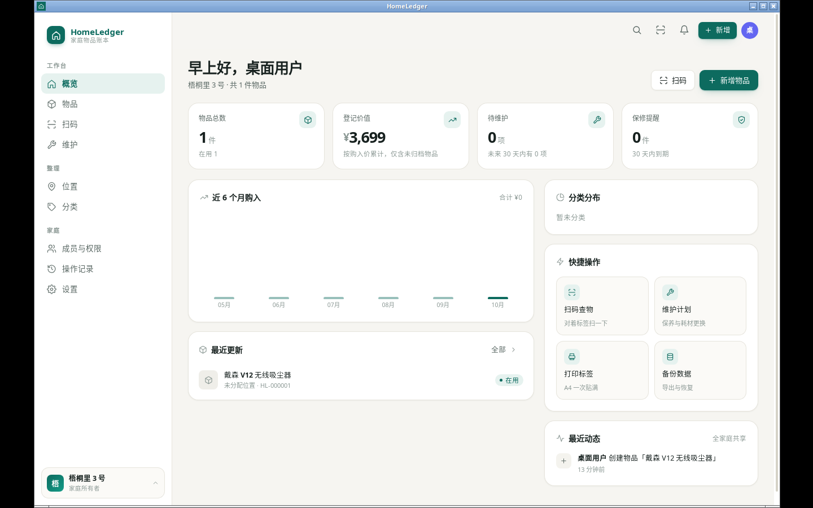
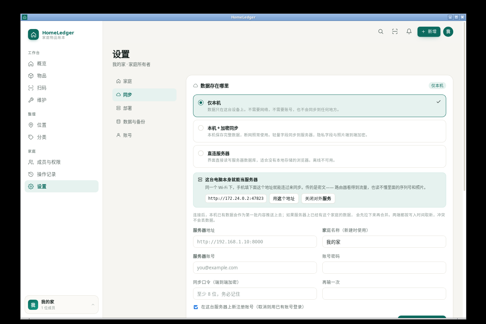

# 桌面端

桌面版是 HomeLedger 的一个终端形态，但它**不是**「把服务器装进一个窗口」——

- 窗口加载的是打包进二进制的 Web 客户端（origin 固定为 `tauri://localhost`）；
- 这个客户端自带一份完整的本机数据库（IndexedDB），断网照常读写；
- 桌面壳（Tauri + Rust）只负责 Web 做不到的四件事：**拉起与守护内置服务**、**系统托盘**、**关窗后继续运行**、**在用户同意后把本机变成局域网服务器**。

内置服务仍然启动，但它的角色变了：不再是「界面背后的数据库」，而是**给家里其他设备连的会合点**。它起不来，本机功能一切正常，只是少了一项跨设备能力。



```
┌──────────────────────────────────────────────────┐
│  Tauri 窗口（WebView，origin = tauri://localhost）│
│  ├── 界面（同一份 React 前端）                     │
│  └── IndexedDB：这台设备自己的完整数据库            │
└───────────┬──────────────────────┬───────────────┘
            │ 可选：加密同步        │ HTTP（仅当用户
            │                       │ 打开了局域网共享）
┌───────────▼──────────────────────▼───────────────┐
│  内置服务 sidecar：python -m app.desktop           │
│  默认 127.0.0.1，可切 0.0.0.0 · SQLite · 同步端点   │
└──────────────────────────────────────────────────┘
```

两套数据是**独立**的：窗口读写的永远是本机 IndexedDB；sidecar 的 SQLite 只保存同步上来的记录和密文附件。这样做的好处是端口变化、sidecar 崩溃、Python 起不来都不影响用户手头的事；代价是同一个家庭在磁盘上有两份数据（本机库 + 服务端库），需要靠同步保持一致——这正是本地优先的定义。

## 数据在哪，服务器从哪来

数据永远在本机，位置见下一节。真正需要选择的是「要不要连一台服务器」，这在**应用内**的「设置 → 同步」里，三选一：

| 模式 | 行为 | 适用 |
| --- | --- | --- |
| 仅本机 | 不连任何服务器 | 一台设备，或还不确定 |
| 本机 + 加密同步 | 本机是数据库，变更加密复制到服务器 | 手机 + 电脑，一家人共享 |
| 直连服务器 | 界面直接读写服务器数据库 | 没有本地存储的浏览器 |



服务器有三种来源，见 [LOCAL_FIRST.md](LOCAL_FIRST.md#服务器从哪来)。其中一种是**这台电脑本身**：在同一个设置页点「允许家庭内设备连接」，sidecar 就会从 `127.0.0.1` 切到 `0.0.0.0`，界面显示 `http://192.168.x.x:端口`，填到手机里即可。开关状态存在 `<数据目录>/desktop.json` 的 `lanShare` 字段，默认 `false`。

`desktop.json` 里还留着 `mode`（`local` / `remote`），它现在只表示「要不要起 sidecar」，不再影响窗口加载什么。旧版本用它记录「去连哪台网关」，字段 `remoteUrl` 仅为兼容保留。

## 你可能会遇到的几个「为什么」

**端口为什么是固定的 47823？**
浏览器的 `localStorage` 按 origin 隔离。端口一变，origin 就变，登录态就丢。所以桌面版固定端口、固定 origin，重启后不用重新登录。端口被别的程序占用时依次试 47824–47832，最后才交给系统随机分配 —— 那种情况下需要重新登录一次。

**关闭窗口为什么不退出？**
内置服务是常驻进程。关窗即退会让「手机还能不能访问」变成随机事件。默认关窗最小化到托盘，真正退出用托盘菜单里的「退出」。

**什么时候会监听局域网端口？**
只在你按下「允许家庭内设备连接」之后。默认绑定 `127.0.0.1`，因为「同一 Wi-Fi 下所有设备都能打开登录页」不该是默认状态——咖啡馆、宿舍、公司网络都是局域网。打开后接口本身仍然要求登录，传输的数据里隐私字段是密文，所以暴露的是登录页，不是内容。想对外网开放请用 [DEPLOYMENT.md](DEPLOYMENT.md) 里的反代 + HTTPS 方案。

**托盘里的「立即备份」怎么鉴权？**
它走 `POST /api/v1/desktop/backup`，需要 `X-Desktop-Token`，值存在 `<数据目录>/.desktop_token`（权限 `0600`）。这条路由只在 `HOMELEDGER_DESKTOP_SHELL=1` 时才注册，网关和云端部署里根本不存在。并且它只能**创建**备份，不能恢复、不能删除。

**切到「直连服务器」之后为什么不是白屏了？**
桌面窗口的 origin 是 `tauri://localhost`，不是一个 http 源。以前用相对路径 `/api/v1` 发请求，打中的是 WebView 自己的资源处理器，而不是用户填的服务器，于是请求必然失败、界面永远停在加载态。现在地址是显式保存的，连不上时显示的是一个**连接页**：

- 状态行实时显示探测结果，地址输入框保留上次填的值；
- 自动重试（3s 起，逐次翻倍到 30s），系统网络恢复时立即重试一次；
- 「改用本机模式」是常驻的逃生门——本机数据一直都在，不该被一台连不上的服务器挡住。

判定依据是「网络层是否失败」（`status === 0`），不是「有没有报错」。401 说明服务器活着，该去登录页；`status === 0` 说明根本没连上，去登录页只会让人输完密码再失败一次。渲染异常另有 `ErrorBoundary` 兜底，不会再出现一片白。

## 数据存放在哪

| 平台 | 路径 |
| --- | --- |
| Linux | `~/.local/share/homeledger/`（遵循 `XDG_DATA_HOME`） |
| macOS | `~/Library/Application Support/HomeLedger/` |
| Windows | `%APPDATA%\HomeLedger\` |

托盘菜单「打开数据目录」直接跳转。备份包、附件、日志都在里面，拷走这个目录就等于拷走了全部数据。

## 从源码运行

不需要打包，桌面壳会自动回退到源码模式：

```bash
# 1. 先让前端产物就位（桌面窗口加载的是后端托管的静态文件）
cd frontend && pnpm install && pnpm build && cd ..

# 2. 指定后端位置与解释器，然后跑桌面壳
cd src-tauri
HOMELEDGER_BACKEND_DIR=../backend \
HOMELEDGER_PYTHON=$(which python3) \
cargo run
```

`HOMELEDGER_PYTHON` 指向的解释器必须装好 `backend/requirements.txt` 里的依赖。如果 `backend/.venv/` 存在，会自动优先使用它。

Linux 需要系统依赖：

```bash
sudo apt install libwebkit2gtk-4.1-dev libayatana-appindicator3-dev \
                 librsvg2-dev libxdo-dev libssl-dev build-essential
```

## 构建安装包

```bash
./scripts/build-desktop.sh
```

三步：前端产物 → PyInstaller 单目录后端 → Tauri 打包。产物在 `src-tauri/target/release/bundle/`。

`src-tauri/server/` 为空时壳仍然能编译和运行——它会退回到 `python -m app.desktop`。这在开发机上可行，但分发出去必然失败（用户没有 Python 环境）。所以正式出包前一定要先跑 sidecar 打包；`build-desktop.sh` 已经把顺序固定好了，别跳步。

| 参数 | 作用 |
| --- | --- |
| `--skip-frontend` | 只改了后端/壳 |
| `--skip-sidecar` | 只改了前端 |
| `--debug` | 带调试符号，不优化 |

Windows 用 `scripts\build-desktop.ps1`（同样的三步），Android 用 `scripts/build-android.sh`。
哪个平台能出什么包、为什么有些包必须换机器打，见 [PACKAGING.md](PACKAGING.md)。

### 一个必踩的坑：Python 必须是共享库构建

PyInstaller 要把 `libpython` 一起打包。用 pyenv 默认参数编译出来的解释器是**静态**的（`Py_ENABLE_SHARED=0`），PyInstaller 会以 `Python was built without a shared library` 失败——这句话看起来像 PyInstaller 的 bug，其实是解释器的属性。

```bash
# 查一下当前解释器
python3 -c "import sysconfig; print(sysconfig.get_config_var('Py_ENABLE_SHARED'))"
# 0 → 不可用；1 → 可用
```

脚本会先做这个检查并直接告诉你换哪个解释器：

```bash
PYTHON=/usr/bin/python3 ./scripts/build-desktop.sh
```

官方 python.org 安装包、Homebrew、Debian/Ubuntu 的 `python3` 都是共享库构建，一般不受影响。

构建机网络慢时，可先配置 PyPI / crates.io 镜像。

### 关于体积

sidecar 用 PyInstaller **单目录**模式而非单文件：

- 单文件每次启动要解压约 70MB 到临时目录，桌面应用凭空多 2–3 秒启动时间；
- 单目录只解压一次（安装时），启动是即时的。

代价是安装包变大（约 90–110MB），这是把 Python 运行时打包进去的必然结果。

## 故障排查

| 现象 | 先看这里 |
| --- | --- |
| 卡在启动画面 | `<数据目录>/logs/desktop.log` 与 `logs/sidecar.log` |
| 提示「已在运行」但看不到窗口 | 从托盘图标打开；托盘不可见时 `pkill homeledger-desktop` 后重启 |
| 端口被占用 | 关掉占用 47823 的程序，或接受随机端口（需重新登录一次） |
| 中文显示成方块 | Linux 缺少中文字体：`sudo apt install fonts-wqy-microhei` |
| 切到直连服务器后停在连接页 | 连接页会写原因：没填地址、解析不到主机、超时、被拒绝。先在浏览器打开 `http://地址:端口/api/v1/system/health` 验证 |
| 手机扫二维码打不开 | 「设置 → 同步 → 二维码查看服务」里看 `reachable`。为 `false` 说明服务只听 `127.0.0.1`，先打开「允许家庭内设备连接」 |

启动失败时，启动画面会直接显示 sidecar 的最后十几行 stderr，不用先去翻日志。

## 已知边界

- **没有自动更新**。Tauri 的 updater 需要签名密钥与发布服务器，属于发布流程而非代码，暂未接入。
- **多端冲突合并只在「本机 + 加密同步」模式生效**。桌面版当服务器时，它自己的 SQLite 是服务端库，窗口读写的仍是本机 IndexedDB，两者通过同步收敛；「直连服务器」模式则是界面直接读写服务端库，不参与本地库。
- **单实例依赖两种机制**：有 D-Bus 会话总线时由 `single-instance` 插件唤回已有窗口；没有时退化为文件锁，只保证不双开，不保证能唤回窗口。
- **未签名的安装包**：macOS 首次打开需在「隐私与安全性」里放行，Windows 会弹 SmartScreen。正式分发需要代码签名证书。
