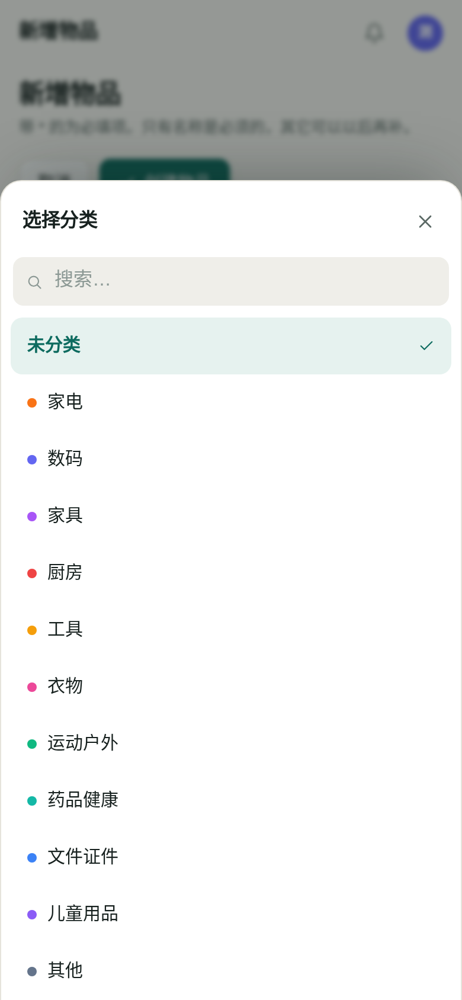
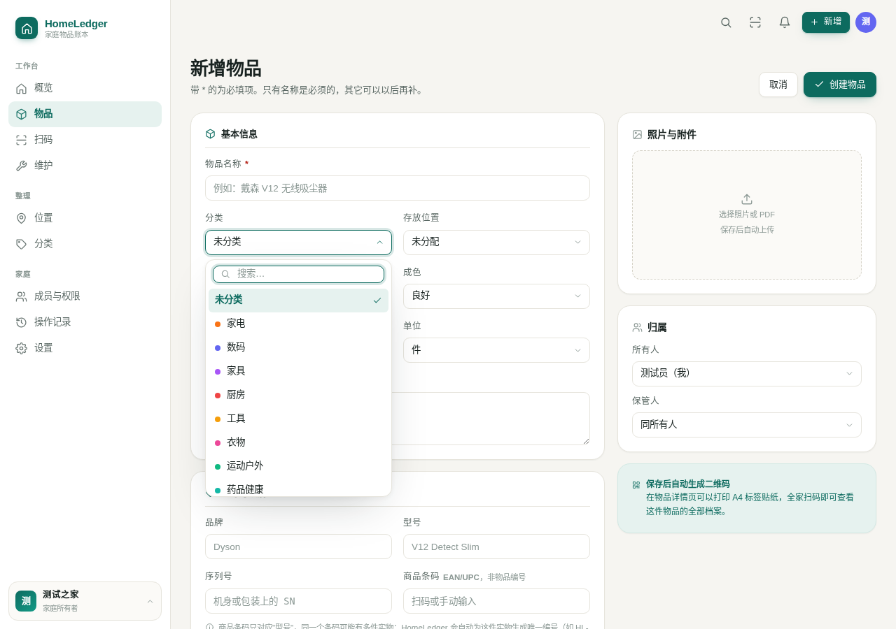

# 手机端

这个产品的主要输入端是手机：站在货架前拍一张、扫一下、填两个字段，比坐在电脑前敲键盘现实得多。所以手机不是「桌面端的缩水版」，它是主路径；桌面端和大屏反而更像整理和打印的工作台。

这份文档写手机端做了什么、为什么这么做，以及哪些只在模拟环境里验过。

---

## 1. 相机权限：声明一次，剩下的交给系统

三件事必须同时成立，相机才打得开：

| 层 | 需要什么 | 谁负责 |
| --- | --- | --- |
| 清单 | `android.permission.CAMERA` | `AndroidManifest.xml`（由构建脚本幂等补齐） |
| 运行时 | 用户点一次「允许」 | wry 的 `RustWebChromeClient.onPermissionRequest` |
| 页面 | `getUserMedia` 拿到流 | `pages/Scan.tsx` |

中间那一层最容易写错。`<input capture>` 和 `getUserMedia` 的权限路径完全不同：后者在 WebView 里会先触发 `onPermissionRequest`，App 必须在回调里决定允许还是拒绝，否则 `getUserMedia` 直接抛 `NotAllowedError`——用户根本看不到系统对话框，只会看到「没有权限」，而系统设置里那个开关还是灰的。

wry 0.57 已经把这套做完了：

```kotlin
// RustWebChromeClient.kt（依赖里的实现，不是我们写的）
if (resources.contains(PermissionRequest.RESOURCE_VIDEO_CAPTURE)) {
  permissionList.add(Manifest.permission.CAMERA)
}
if (permissionList.isNotEmpty() && Build.VERSION.SDK_INT >= M) {
  activity.requestPermissions(permissions) { granted -> if (granted) request.grant(...) else request.deny() }
}
```

所以 `MainActivity` 里**没有**任何权限代码。手写一遍只会和 wry 抢同一个回调。我们只需要保证清单里有 `CAMERA`，并且**不要**把它声明成必需硬件：

```xml
<uses-permission android:name="android.permission.CAMERA" />
<uses-permission android:name="android.permission.ACCESS_NETWORK_STATE" />
<uses-feature android:name="android.hardware.camera" android:required="false" />
```

`required="false"` 不是客套：声明成必需，没有摄像头的平板和电视盒子在商店里就看不到这个应用。而扫码只是录入方式之一，手输、贴纸、CSV 导入都还在。

被拒绝之后，扫码页给的是**可执行**的话，不是「权限不足」：

| 错误 | 文案 |
| --- | --- |
| `NotAllowedError` / `SecurityError` | 相机权限被拒绝。去系统设置里打开「相机」权限，或用下方的手动输入 |
| `NotFoundError` | 这台设备上没有可用的摄像头。手动输入同样能建档 |

手动输入框一直在页面上，不是失败之后才出现的补救。

---

## 2. 全屏：尽力而为，布局兜住两种结果

原生侧申请沉浸式：

```kotlin
WindowCompat.setDecorFitsSystemWindows(window, false)
controller.systemBarsBehavior = BEHAVIOR_SHOW_TRANSIENT_BARS_BY_SWIPE
controller.hide(WindowInsetsCompat.Type.statusBars())
```

`onWindowFocusChanged` 里再调一次，因为从相机、文件选择器、权限对话框返回时，系统会把状态栏放出来。

但**结果不由应用决定**：分屏、某些定制 ROM、用户在系统设置里锁定状态栏，都会让它失败。所以布局不假设「状态栏一定没了」，只用安全区补白：

```css
.topbar {
  height: calc(56px + env(safe-area-inset-top));
  padding-top: env(safe-area-inset-top);
}
```

全屏生效 → inset 为 0 → 顶栏贴顶；全屏失败 → inset 等于状态栏高度 → 顶栏自动让开。**同一份 CSS 覆盖两种结果，没有运行时检测，也不会闪一下。**

`viewport-fit=cover` 是前提，漏了它 `env()` 恒为 0，看起来就像「安全区没生效」。

> 用户提过的备选方案是「拿不到全屏就把窗口缩小一点」。没有采用：那等于在一块已经被系统栏占掉一条的屏幕上再缩一圈，同时损失两次空间。

---

## 3. 下拉是画出来的，其余控件仍是原生的

分类、位置、状态、排序这些下拉，展开的是应用自己的面板（`Select`，见 `components/ui.tsx`），不再是 `<select>`。

理由不是「想好看一点」。安卓上原生 `<select>` 展开的是一张**独立的系统单选列表**：全屏白底、系统字体、42px 行、没有一处品牌色。它从「新增物品」这个已经画好的弹窗里弹出来，看起来就是另一个应用的界面突然盖在上面。这是产品一致性的问题，不是审美问题。

具体做法：

| 场景 | 呈现 |
| --- | --- |
| ≤860px | 从底部升起，与 Modal 共用圆角 / 阴影 / 遮罩，48px 行高，`env(safe-area-inset-bottom)` 让开手势条 |
| 桌面 | 锚定触发器的浮层，下方放不下就向上翻，最高 340px |
| 选项 > 10 个 | 自动出现搜索框（分类 12 项，维护任务里的物品可能几百项） |
| 键盘 | ↑↓ 移动、Enter 选中、Esc 关闭并回到触发器；`role="listbox"` + `aria-activedescendant` 让读屏念出当前项 |
| 手机键盘弹起 | `visualViewport` 把抽屉整体上移——`innerHeight` 不会因为键盘而改变，拿不到被遮住的高度 |

代价说清楚：系统选择器自带惯性滚动和「取消 / 确定」，我们没有。换来的是可控的视觉、搜索、以及能把分类色点画进选项里。

| 手机：底部抽屉 | 桌面：锚定浮层 |
| --- | --- |
|  |  |

**日期仍然用 `<input type="date">`**。日历控件重做的工作量和风险都比下拉高一个量级，而且它是全屏面板，不存在「像另一个应用」的错位感。数字用 `inputMode="numeric"`，开关用 `<input type="checkbox">` 加样式——这些都没必要重写。

同类的还有确认对话框。`window.confirm` 在 WebView 里样式由系统决定，更糟的是在某些 WebView 里**根本没有实现**：点按钮什么都不发生，函数直接返回 `false`。而「清空本机数据库」「断开同步」「作废二维码」全拦在它后面——表现就是按钮点了没反应。现在统一走 `useConfirm()`，渲染的还是应用自己的 Modal：

```tsx
const [confirm, confirmDialog] = useConfirm();
if (!(await confirm("已经贴出去的码会全部失效。", { title: "作废这个二维码" }))) return;
return <>{confirmDialog}…</>;
```

触控尺寸和字号有两条硬要求：

```css
.input { height: 44px; font-size: 16px; }
.btn { height: 42px; }
.icon-btn { width: 40px; height: 40px; }
```

- **44px** 是苹果 HIG 的最小点击区域，也是安卓 48dp 指导值的下限附近。手指不是鼠标，38px 的按钮在走路时会点空。
- **16px** 是 iOS Safari 的硬门槛：输入框字号小于 16px 时，聚焦会强制放大整个页面，而放大之后页面再也回不到原来的比例——用户只能杀掉应用重开。这一条比「看起来字号合适」重要得多。

---

## 4. 扫码：先用系统的，没有就自己算

`BarcodeDetector` 是首选：硬件加速、认识十几种码制、不增加包体积。问题是它**不在打包应用里**——Chrome for Android 有，但 App 跑的是 Android WebView，WebView 没有；Linux 桌面的 WebKitGTK 也没有。只依赖它，结果就是「在唯一需要扫码的设备上，相机打开后礼貌地告诉你扫不了」。

于是有回退：

```
BarcodeDetector 存在 → 直接 detect(video)
否则                → canvas 抓帧（长边 640px）→ jsQR 解像素
```

几个具体数字和它们的理由：

- **640px 长边**：25mm 的贴纸拿在手边，640px 足够解出；4K 帧的解码成本是它的二十倍。
- **~120ms 一帧**（约 8fps）：jsQR 是纯 JS，跑满帧率会让手机发烫、取景框卡顿。人举着手机对准标签的动作，8fps 完全够。
- **`inversionAttempts: "dontInvert"`**：反色二维码只在电子屏上出现，纸上的贴纸永远是深码浅底。省掉一次全图反相。
- **懒加载**：`await import("jsqr")` 让 30 kB 只在真正要扫的时候才下载。从不扫码的用户不为它付出首屏时间。

`canScan()` 只判断「有没有 canvas」，用来决定要不要显示扫码入口——不判断 `BarcodeDetector`，否则在 WebView 里会把唯一可用的路径藏起来。

### 4.1 预览黑屏：`<video>` 必须一直挂在 DOM 里

拿到流不等于有画面。第一版把 `<video>` 写在 `camOn ? … : …` 里面，点「打开相机」
的那一刻组件还没重新渲染，`videoRef.current` 是 `null`，`srcObject` 压根没绑上：
相机指示灯亮着、系统权限也给了，取景框永远是一块黑。等第二次渲染把 `<video>`
挂出来时，赋值那一步已经过去了，没有人再补。

现在 `<video>` 常驻，不开相机时只是 `opacity: 0`；绑完流、`play()` 之后还要等
`videoWidth > 0`（`waitForFirstFrame`）——Android WebView 会在 `play()` resolve
之后的几帧里仍然报 `readyState = 0`。这两步省掉任何一步，jsQR 都会对着空画布
返回 `null`，表现成「相机开着但什么也扫不出来」，和黑屏是同一个 bug 的两种长相。

顺带把失败原因分开了：`NotAllowedError`（拒权）、`NotFoundError`（没摄像头）、
`NotReadableError`（被别的应用占用）、`NotSupportedError`（非安全上下文，
`http://192.168.x.x` 拿不到 `getUserMedia`）各说各的话。以前一律是「无法启动相机，
请检查设备是否有摄像头」，对着一台有摄像头的手机说这句话，等于没说。

---

## 5. 连不上服务器时不白屏

手机最常见的情况是「在家里连过，出门换了网络」。旧行为是一片白，用户只能杀掉重开。

现在分四种情况给四个界面：

| 情况 | 界面 |
| --- | --- |
| 没填过服务器地址 | 连接页，地址输入框为空，下面有「改用本机模式」 |
| 地址不可达 | 连接页，显示探测失败原因，自动重试（3s→30s），地址保留 |
| 服务器在但返回 401 | 登录页（说明服务器是活的，只是要登录） |
| 前端自己崩了 | 错误边界，三个按钮：重试 / 重新加载 / 改用本机模式 |

判据是 `status === 0`（网络层失败），不是「有没有报错」。把 401 也当成连不上，会让人输完密码再失败一次。

本机数据一直都在。逃生门必须显眼——用户只是被一台连不上的服务器挡住了，不是数据没了。

---

## 6. 手机上看到的二维码是别人的手机

自己扫自己的贴纸没意义。真正发生的场景是：亲戚来家里，看到冰箱上贴的码，用自己的手机扫开，看到「美的 电饭煲 · 厨房 / 橱柜 / 第二层 · 保修到 2027-03」。

所以那个页面不是给 App 用的：

- 服务端渲染 HTML，不加载前端框架，一次请求就出内容；
- `viewport-fit=cover`，刘海屏上也正常；
- 浅色/深色跟随系统；
- 只在内网可访问，外网拿到链接也打不开。

服务端平时不占资源，扫了才醒，人走了 90 秒后睡回去。这一整套在 [API.md](API.md#公开扫码页public) 和 ADR-028~030 里。

---

## 7. 哪些没在真机上验过

诚实列出来：

| 项 | 现状 |
| --- | --- |
| 相机权限对话框 | 逻辑链已核对 wry 源码，APK 已确认声明 `CAMERA`；未在真机上点过「允许/拒绝」 |
| 沉浸式全屏 | 代码已进包，未在刘海屏和挖孔屏真机上看过实际效果 |
| iOS 输入框不缩放 | 16px 规则已落地，未在 iPhone 上验证 |
| jsQR 在低端机上的帧率 | 只在桌面 Chrome 里量过，未在千元机上量 |
| 抽屉里搜索时键盘避让 | `visualViewport` 路径在 Chromium 移动模拟下测过，未在 iOS Safari 上验证（那里键盘行为和安卓不同） |
| 抽屉下滑关闭 | 没有做手势关闭，只有点遮罩 / 关闭按钮 / Esc |

这几项都需要一台真手机。打包、权限声明、资源内嵌都已确认无误（`aapt2 dump badging` + 从 `.so` 里 `strings` 出前端哈希），缺的只是最后一步实机确认。

---

## 8. 怎么自己验

```bash
# 1. 装包
adb install -r dist/HomeLedger_1.0.2_aarch64.apk

# 2. 看权限有没有声明进去
$ANDROID_HOME/build-tools/36.0.0/aapt2 dump badging dist/HomeLedger_1.0.2_aarch64.apk | grep -E 'CAMERA|ACCESS_NETWORK|camera'

# 3. 看前端是不是最新的（哈希要和 frontend 构建输出一致）
unzip -p dist/HomeLedger_1.0.2_aarch64.apk lib/arm64-v8a/libhomeledger_desktop_lib.so \
  | strings | grep -o 'index-[A-Za-z0-9_-]*\.js'

# 4. 装完打开 App → 我的 → 页面底部
#    「HomeLedger v1.0.2 · 界面构建 2026-10-30 11:30」
#    这一行对不上，就是装到了旧包。

# 5. 真机点一遍：扫码 → 允许相机 → 扫贴纸 → 建档 → 打印
adb logcat -s Tauri:V chromium:V | grep -i "permission\|camera"
```

第 3 步容易被忽略：Tauri 的安卓包把前端打进 `.so` 而不是 `assets/`，所以 `unzip -l` 里看不到 JS 文件，只有 `tauri.conf.json`。看不到不等于没打进去。

第 4 步是给「我明明改了，怎么还是老样子」准备的。版本号只说明发了几版，构建指纹说明是哪一次编译——两者都对不上时，先看这一行，再怀疑代码。
